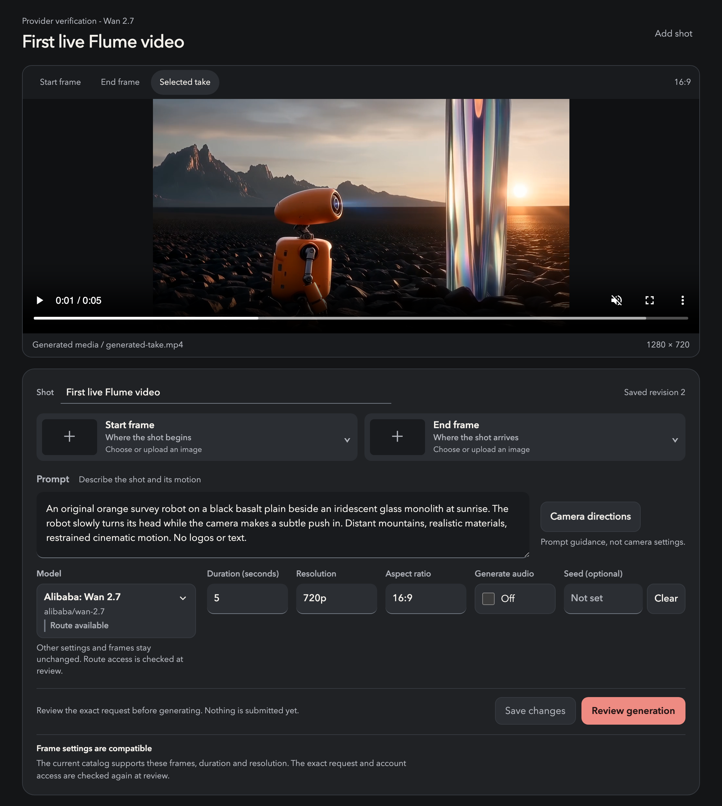
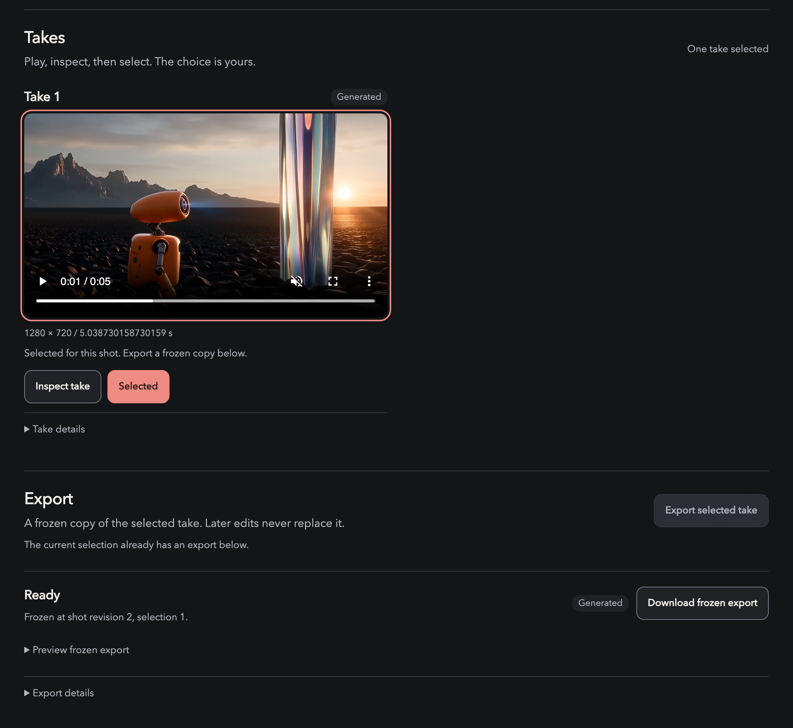

# Flume


**A local workspace for preparing image-to-video shots.**

Flume keeps the direction behind a shot in one editable place: the prompt, the model controls, and
the owned start and end frames that condition the result. Before anything is generated, it shows
the exact request and the provider blockers that stand in the way, so the decision to generate is
explicit rather than implied.

Flume's browser workspace, API, PostgreSQL store, and headless client run on your machine over
the same operations. It is built for work where the frame you start from
and the frame you end on are separate creative decisions, not generic image references.

> **Status: local-development checkpoint.** This is not a production release. The browser app, API,
> database, and core editing workflow run locally. A live Wan 2.7 generation has completed through
> review, approval, owned-media retrieval, take selection and export. Startup remains edit-only
> unless explicitly configured; other routes are not implicitly enabled. Unreleased branch work
> is not included in the capabilities described below.

## Product workspace



*The publication-branch UI showing the owned result of a real application run. This is not a mockup
or a storyboard preview. Screenshot provenance is recorded with the [verification result](docs/results/wan-2.7/README.md).*

## Live generation result

[](docs/results/wan-2.7/flume-wan-2.7.mp4)

**Wan 2.7 · 5-second video · 1280 × 720 · 30 fps · $0.50 reported cost for this run**

Generated through Flume's **review → approval → single submit → owned take → inspection →
selection → frozen export** workflow. The animation is a compressed preview; [download the
unmodified exported MP4](docs/results/wan-2.7/flume-wan-2.7.mp4) or read the
[settings, output details and verification limits](docs/results/wan-2.7/README.md).

## Mood film

[](readme-promos/alien-reel/flume-alien-v002.mp4)

A 29.5-second original film joining three studies with two generated transitions: an iridescent crystal
flower assembling in a black void morphs into a river of liquid mirror, which pours through
volcanic glass and becomes luminous creatures grazing under a violet aurora — each world
transforming into the next. [Watch the full MP4](readme-promos/alien-reel/flume-alien-v002.mp4)
(29.5&nbsp;s, 1080p, silent by design). This is creative material assembled outside the app — not
a demonstration of in-app generation. Provenance and checksums live in
[readme-promos](readme-promos/README.md).

## At a glance

| Area | State |
| --- | --- |
| Project and shot workspace, owned-image import (PNG, JPEG, WebP) | Works locally |
| Separate start and end frame bindings, with per-role controls | Works locally |
| Prompt and control editing with persisted, reloadable state | Works locally |
| Generation review showing both frame roles and provider blockers | Works locally |
| Generation orchestration, owned takes, explicit inspection/selection and frozen MP4 export | Exercised with controlled providers and one live Wan 2.7 application workflow |
| Live generation | Wan 2.7 verified with explicit configuration and prior-job evidence; default startup remains edit-only |
| Recovery paths and launcher shutdown edge cases | Not yet fully verified |

## What works today

In the local browser you can:

- Create projects and shots, and import PNG, JPEG, or WebP images you own.
- Bind distinct start and end references, with separate controls for each role.
- Edit and save the prompt and controls, then reload the page to see the saved state.
- Prepare a generation review showing both frame roles and provider blockers.

These editing actions are verified against the real client and API, not a mock UI. A live
five-second, 720p Wan 2.7 request completed through the application's review, approval, single-submit,
retrieval, playback/inspection, explicit selection and frozen-export path. The returned media was
downloaded and hash-verified. That bounded result does not prove other models, image-conditioned
generation, future account access or complete recovery behavior. The default app has no
sample-generation mode, and new takes are never selected automatically.



*One generated take, explicitly selected, with a ready frozen export. The screenshot is cropped
to the product surface; unrelated projects and provider identifiers are not published.*

## Requirements

| Requirement | Notes |
| --- | --- |
| Node.js 26.8.1 | Pinned in [`.node-version`](.node-version). The root engine allows `>=22.12.0` and `@flume/media` requires `>=22.18.0`; use the pinned version. |
| npm 11.19.0 | Declared as `packageManager` in [`package.json`](package.json). |
| PostgreSQL | The launcher starts its own local cluster and needs `initdb`, `postgres`, `psql`, and `pg_ctl`. Set `PG_BIN` if they are not found automatically. |
| FFmpeg and ffprobe | Required at startup for media inspection, previews, and export. |

**Platform support:** the runtime media bridge and parts of the test suite assume Homebrew's Apple
Silicon binary locations (`/opt/homebrew/bin`). Although launcher preflight accepts macOS and Linux,
only the macOS layout is currently exercised; other layouts need portability work. Windows is
rejected. The launcher does not install native runtimes.

## Run locally

From the root of your clone:

```sh
npm ci --ignore-scripts
npm run dev:check
npm run dev
```

`dev:check` verifies Node, the product workspaces, and PostgreSQL binary availability. It starts no
services and creates no store, but it does not check FFmpeg or the test prerequisites below.

`dev` builds the workspaces, starts a local PostgreSQL cluster, runs migrations before API startup,
and launches the API and web app. It installs npm dependencies automatically if `node_modules` is
missing. Worker phases run inside the API process; do not start a separate database server or
worker.

Then open <http://127.0.0.1:4310>. API health is at <http://127.0.0.1:4311/api/health>. Ports are
configurable with `FLUME_WEB_PORT` and `FLUME_API_PORT`; if a port is occupied, choose another
rather than stopping a service you do not own.

## Try the editing workflow

1. Create a project and a shot.
2. Import two images you own and assign them as the start and end frames.
3. Write the prompt, adjust the controls, and save.
4. Reload the page to confirm the state persisted.
5. Prepare a generation review to see the frozen request and any provider blockers.

This walkthrough uses the default edit-only configuration. For an explicitly authorized live
route, follow [provider configuration](apps/server/PROVIDER-CONFIGURATION.md). Configuration does
not submit a job: review and approval remain separate actions.

## Configuration

| Variable | Purpose |
| --- | --- |
| `FLUME_WEB_PORT`, `FLUME_API_PORT` | Override the default ports (4310 and 4311). |
| `PG_BIN` | Directory containing the PostgreSQL binaries, when they are not found automatically. |
| `FLUME_FFMPEG_PATH`, `FLUME_FFPROBE_PATH` | Absolute paths to the media executables, for installations outside the Homebrew layout. Plain `FFMPEG_PATH` and `FFPROBE_PATH` are not read. |

The default runtime is edit-only: it loads no generation credentials, and Hailuo 3 is reported as
blocked. Setting an API key in your shell does not by itself enable generation.

[Provider configuration](apps/server/PROVIDER-CONFIGURATION.md) documents server-side credential
injection, account scope, prior-job verification and the supported Wan pricing profile. Do not put
credentials or real job identifiers in source, frontend settings or committed examples.

## Local data, security, and shutdown

The database, media, and logs live under `.flume/` and survive normal shutdown. The root launcher
owns this store; do not run the server package on its own. Ctrl+C requests shutdown, but launcher
cancellation and cleanup still need final integrated verification. Never delete `.flume/`, its
ownership markers, or its locks to fix startup while the owning process might still be running.

The app runs in local-operator mode on loopback interfaces and has no production authentication. Do
not expose it publicly. Do not commit local data, logs, credentials, or unlicensed media.

## Build, typecheck, and test

```sh
npm run build
npm run typecheck
```

These commands rebuild workspace exports in dependency order. `npm test` is the intended full suite
and also rebuilds first. `npm run test:tooling` runs tooling tests and is not a substitute for the
full suite.

Tests use controlled providers with real disposable PostgreSQL clusters and FFmpeg processes. They
need no provider keys and no production `DATABASE_URL`. Run suites sequentially in a clean
environment, never against a shared database or the persistent `.flume/` store.

Tooling tests look for PostgreSQL through `PG_BIN`, `pg_config --bindir`, the macOS
Homebrew location, then `PATH`. Tests using this discovery helper explicitly **skip** when
PostgreSQL is unavailable; a skipped test is not a pass. Check the skip count when reviewing results.

PostgreSQL tests require a short, canonical absolute scratch path that you own. Set `TMPDIR` to that
path, using only letters, numbers, underscores, dots, slashes, and hyphens; Unix socket length limits
also apply. Server and database tests additionally require `FLUME_TEST_SCRATCH_ALLOWED` to match the
canonical path exactly. The opt-in does not replace the ownership and isolation checks.

From the repository root, use a fresh scratch directory and an isolated home for the full suite:

```sh
test_scratch=$(mktemp -d "${TMPDIR:-/tmp}/ft-XXXXXX")
test_scratch=$(cd "$test_scratch" && pwd -P)
mkdir -m 700 "$test_scratch/home"
env -i PATH="$PATH" HOME="$test_scratch/home" TMPDIR="$test_scratch" \
  FLUME_TEST_SCRATCH_ALLOWED="$test_scratch" \
  PG_BIN="${PG_BIN:-$(pg_config --bindir)}" LC_ALL=C npm test
```

The runner forwards this explicit scratch approval without inheriting database connection targets
or provider credentials. Inspect the scratch directory after testing; do not recursively erase it
after a failure, which could hide a leaked process or cluster. Native media executable overrides are
not forwarded by the test runner, so the Homebrew layout limitation above still applies.

## Known limitations

- Video generation requires temporary output retention; OpenRouter does not route ZDR-enforced
  video requests. The Hailuo 3 local hold remains enabled by default, and that route is not verified.
- Only the explicitly evidenced model becomes available. The verified Wan profile is narrow:
  2–10 seconds, 720p/1080p, 16:9, audio requested off and no seed. The live application test covered
  one five-second, text-only 720p request; other combinations are not live-verified.
- Prior completion does not guarantee future acceptance. Estimates are catalog-derived, not
  provider-enforced final-charge caps. There is no automatic model fallback or paid retry.
- Authenticated output retrieval worked for the tested route without a redirect. Other CDN paths
  remain unverified, and redirected content fails closed. Inspect actual output streams: the
  audio-off test still contained an AAC track.
- Confirmation after accepted writes, recovery from failed take previews, and launcher
  cancellation and cleanup corrections still need final integrated verification. There is no manual
  UI for reconciling uncertain provider acceptance, and a provider response alone does not prove
  recovery.

## Project structure

Flume is a TypeScript workspace on React, Vite, Fastify, PostgreSQL, Drizzle, pg-boss, and FFmpeg.

| Path | Contents |
| --- | --- |
| `apps/web` | Browser workspace for projects, shots, references, and review. |
| `apps/server` | API, local runtime, and media bridge. |
| `apps/worker` | Durable job phases, run inside the API process. |
| `apps/cli` | Headless JSON client over the same operations. It never retries or approves a generation. |
| `packages/` | Shared contracts, client, database, providers, media, and UI feature packages. |
| `tools/` | Launcher and workspace runner. |
| `spikes/` | Earlier bounded experiments; not the application entry point. |

## Documentation

- [Product spec](docs/SPEC.md) — product direction and architecture.
- [Foundation blueprint](docs/FOUNDATION-BLUEPRINT.md) — ownership and recovery contracts.
- [Verification plan](docs/VERIFICATION-PLAN.md) — proof obligations for each claim.
- [Architecture transfer](docs/ARCHITECTURE-TRANSFER.md) — control acceptance checklist.
- [Research provenance](docs/PROVENANCE.md) — source references and their limits.
- [Glossary](GLOSSARY.md) — vocabulary shared by the UI, API, and provider adapters.

These are design records. They can describe more than is implemented and are not feature-completion
claims.

## Brand and license

The [brand portfolio (PDF)](docs/brand/FLUME-Portfolio-v003.pdf) presents Flume's visual identity; it
is not evidence of application behavior. Its business-card contact details are illustrative, not
verified support contacts.

Original code and documentation are released under the [MIT License](LICENSE). Third-party
dependencies and reference snapshots retain their own terms. Import or commit only media you own or
are licensed to use.
