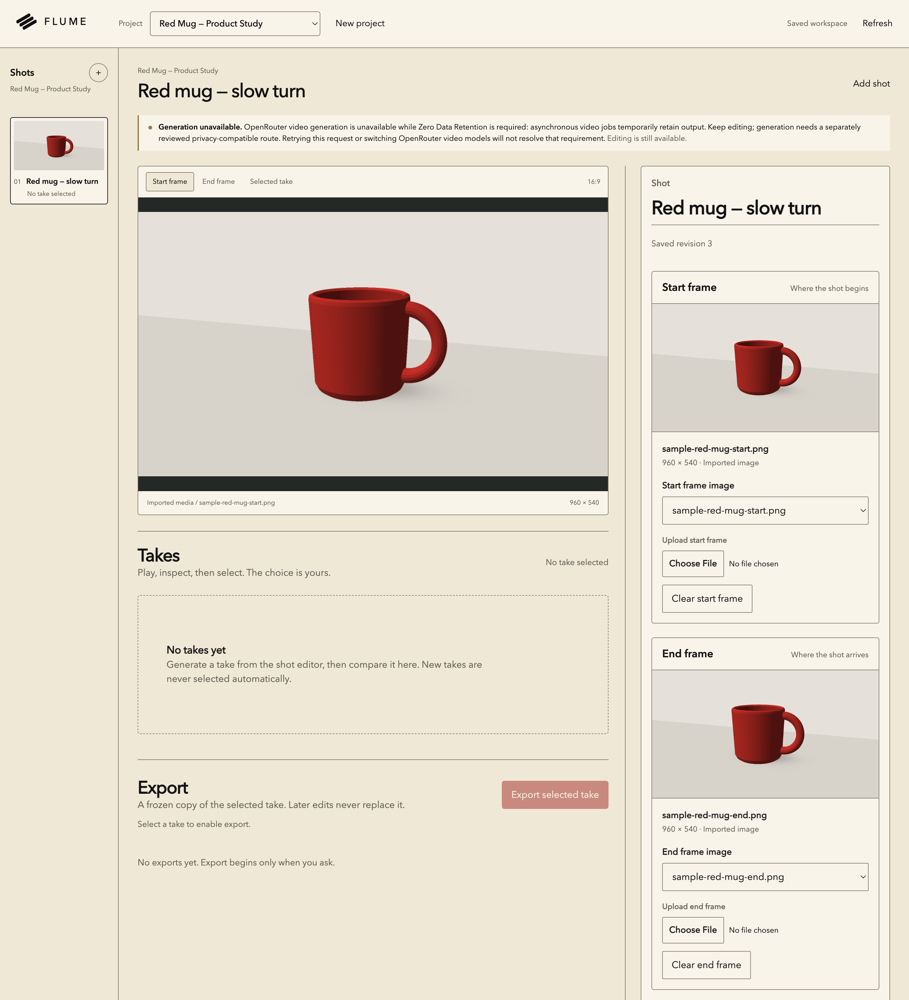

# Flume


Flume is a local application for preparing image-to-video shots. Create projects and shots,
bind owned start and end frames, write a prompt, and review a request before generation.

This is a runnable local-development checkpoint, not a planning-only repository or a production
release. The browser app, API, database, and core editing workflow work locally. The app still
blocks live generation; no successful live video result is verified at this checkpoint.

## What works now

In the local browser you can:

- Create projects and shots, and import owned PNG, JPEG, or WebP images.
- Bind distinct start and end references, with separate controls for each role.
- Edit and save the prompt and controls, then reload the page to see saved state.
- Prepare a generation review showing both frame roles and provider blockers.

These editing actions have been verified against the real client and API, not just a mock UI.
Generation orchestration, approval and submission, attempts, owned takes, explicit inspection and
selection, and MP4 export of a frozen selected take are implemented and exercised with controlled
sample providers. That coverage does not establish live generation or complete recovery behavior.
The default app has no sample-generation mode. New takes are never selected automatically.



The current guarded local build, using synthetic, owned sample references—not generated video.
The visible warning reflects the unchanged app guard, not the account's current ZDR setting.

## Run locally

Use the Node version in [`.node-version`](.node-version), currently 26.8.1, and npm 11.19.0.
The root Node minimum is lower than the media package's requirement; use the pinned version.
Install PostgreSQL with `initdb`, `postgres`, `psql`, and `pg_ctl`, plus FFmpeg and ffprobe.
Set `PG_BIN` to the existing PostgreSQL binary directory if it is not found automatically.
The launcher does not install native runtimes.

**Platform limitation:** the runtime media bridge and some tests assume Homebrew's Apple Silicon
binary locations. Other installation layouts need portability work. Although launcher preflight
accepts macOS and Linux, this is not a verified cross-platform setup. Windows is rejected.
FFmpeg and ffprobe are required at startup; the app does not honor `FFMPEG_PATH` or `FFPROBE_PATH`.

From the root of your clone:

```sh
npm ci --ignore-scripts
npm run dev:check
npm run dev
```

`dev:check` checks Node, product workspaces, and PostgreSQL binary availability. It starts no
services and creates no store, but does not check FFmpeg or the test prerequisites below.
`dev` builds the workspaces, starts its own local PostgreSQL, runs migrations during API startup,
and starts the API and web app. It also installs npm dependencies if `node_modules` is missing.
Worker phases run inside the API process; do not start a separate database server or worker.

Open http://127.0.0.1:4310. API health is at http://127.0.0.1:4311/api/health.
Set `FLUME_WEB_PORT` and `FLUME_API_PORT` to use different ports. If a port is occupied, choose
another rather than stopping a service you do not own.

To try the editing workflow, create a project and shot, import two images you own, choose them
as the start and end frames, and save. Reload to check the saved state, then prepare a generation
review. The current app still shows its Hailuo 3 privacy hold; it is not a live-generation demo.

## Local data and shutdown

The database, media, and logs live under `.flume/` and survive normal shutdown. The root launcher
owns this store; do not run the server package on its own. Ctrl+C requests shutdown, but launcher
cancellation and cleanup still need final integrated verification. Never delete `.flume/`, its
ownership markers, or locks to fix startup while the owning process might still be running.

The app runs in local-operator mode on loopback interfaces, not with production authentication.
Do not expose it publicly. Do not commit local data, logs, credentials, or unlicensed media.

## Builds, checks, and tests

```sh
npm run build
npm run typecheck
```

These commands rebuild workspace exports in dependency order. `npm test` is the intended full suite
and also rebuilds first. `npm run test:tooling` runs tooling tests, not a substitute full suite.

Tests use controlled providers with real disposable PostgreSQL clusters and FFmpeg processes.
They need no provider keys or production `DATABASE_URL`. Run suites sequentially in a clean
environment, never against a shared database or the persistent `.flume/` store.

PostgreSQL tests require a short, canonical absolute scratch path that you own. Set `TMPDIR` to
it; use only letters, numbers, underscores, dots, slashes, and hyphens. Unix socket length limits
also apply. Server/database tests require `FLUME_TEST_SCRATCH_ALLOWED` to match that canonical
path exactly. This opt-in does not replace the ownership and isolation checks.

From the repository root, use a fresh scratch directory and an isolated home for the full suite:

```sh
test_scratch=$(mktemp -d "${TMPDIR:-/tmp}/ft-XXXXXX")
test_scratch=$(cd "$test_scratch" && pwd -P)
mkdir -m 700 "$test_scratch/home"
env -i PATH="$PATH" HOME="$test_scratch/home" TMPDIR="$test_scratch" \
  FLUME_TEST_SCRATCH_ALLOWED="$test_scratch" \
  PG_BIN="${PG_BIN:-$(pg_config --bindir)}" LC_ALL=C npm test
```

The runner forwards this explicit scratch approval without inheriting database connection targets
or provider credentials. Inspect the scratch directory after testing; do not recursively erase it
on a failure, which could hide a leaked process or cluster. Native media executable overrides are
not forwarded by the test runner; the Homebrew layout limitation above still applies.

## What remains blocked or unverified

- Earlier Hailuo 3 requests were rejected under OpenRouter's zero-data-retention (ZDR) policy.
  The account owner now reports ZDR disabled. That change is not yet a verified live result.
- The app still has an explicit Hailuo 3 privacy hold and loads no generation credentials.
  Connecting the app to the changed account remains pending validation. Adding an API key to
  your shell does not enable generation through this entry point; no fallback was selected.
- Live output retrieval and CDN compatibility are unverified; redirected content fails closed.
- Confirmation after accepted writes, recovery from failed take previews, and launcher
  cancellation/cleanup corrections still need final integrated verification. There is no manual
  UI to reconcile uncertain provider acceptance. A response alone does not prove recovery.

## Code and design records

The current stack is React, TypeScript, Vite, Fastify, PostgreSQL, Drizzle, pg-boss, and FFmpeg.
`apps/web` is the browser app; `apps/server` owns the API and runtime; `apps/worker` supplies durable
job phases; `apps/cli` uses the shared client. `packages/` contains the contracts, client, database,
providers, media, and UI features. `tools/` contains the launcher and workspace runner.
`spikes/` holds earlier bounded experiments, not the current application entry point.

Read the [product spec](docs/SPEC.md), [foundation blueprint](docs/FOUNDATION-BLUEPRINT.md),
[verification plan](docs/VERIFICATION-PLAN.md), and [glossary](GLOSSARY.md) as design records and
vocabulary. They can describe more than is implemented; they are not feature-completion claims.

## Brand and license

The [brand portfolio (PDF)](docs/brand/FLUME-Portfolio-v003.pdf) presents Flume's visual identity,
not evidence of application behavior. Its business-card contact details are illustrative,
not verified support contacts.

Original code and documentation use the [MIT License](LICENSE). Third-party dependencies and
reference snapshots retain their own terms. Import or commit only media you own or are licensed to use.
