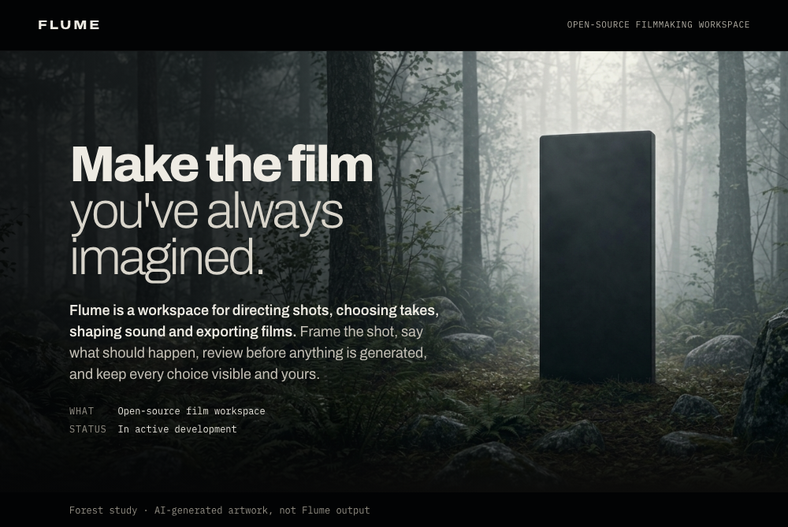
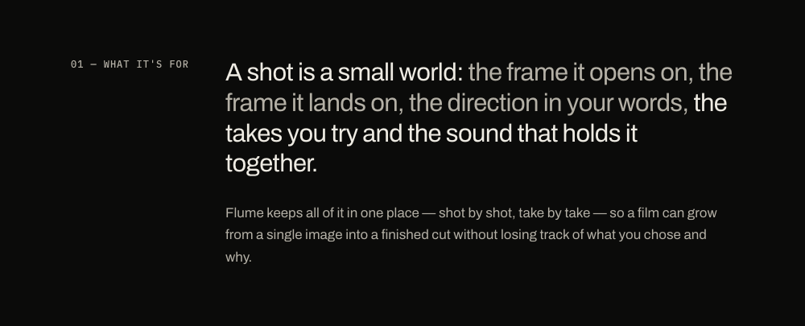
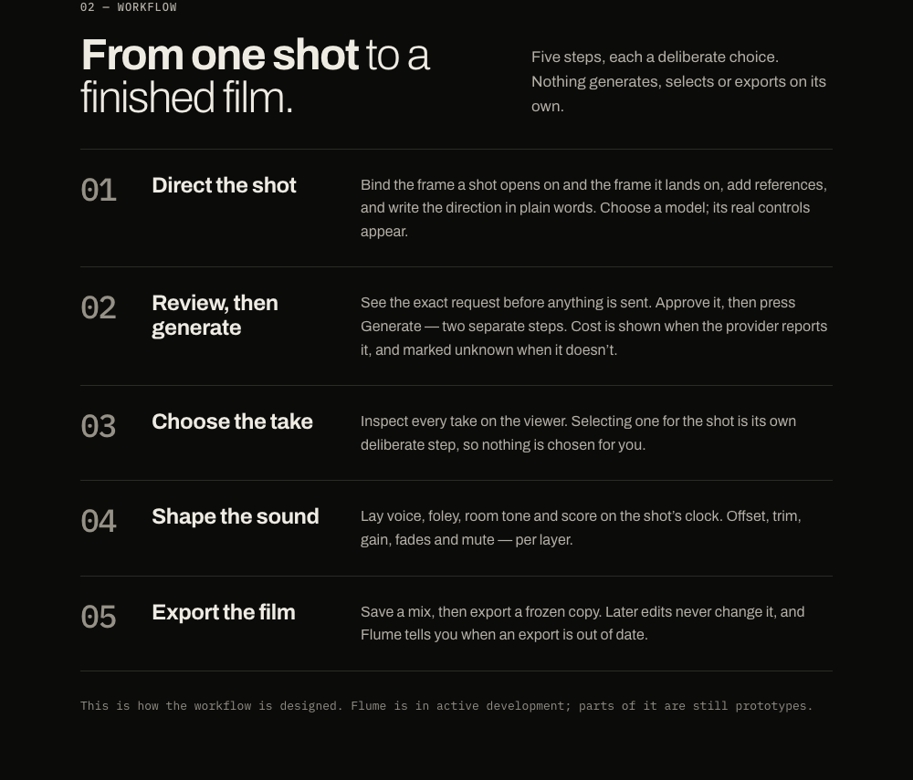
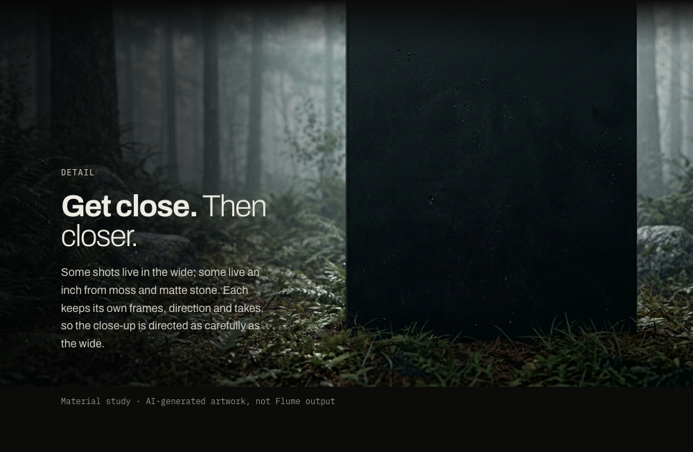
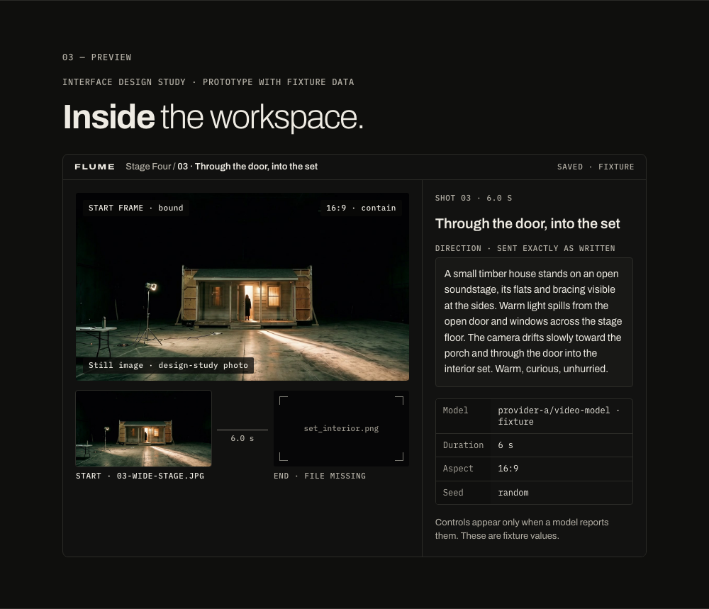
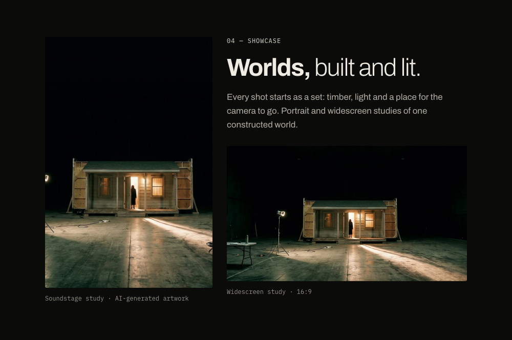
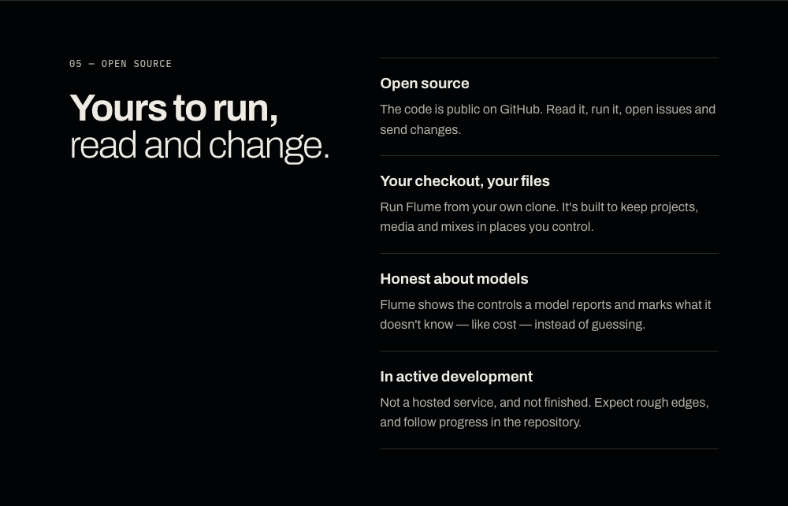

<p align="center">








</p>

## Build, run and verify

[**Get started →**](DEVELOPMENT.md#run-locally) · [Current capabilities](DEVELOPMENT.md#at-a-glance) · [Verified live result](docs/results/wan-2.7/README.md) · [Mood film](readme-promos/README.md)

```sh
git clone https://github.com/pkidwell22/Flume
```

The visual introduction is a GitHub-specific adaptation of the landing-page design, without
website navigation or decorative buttons. Its workspace illustration is a labelled **prototype**,
not a screenshot of the current application. The [development guide](DEVELOPMENT.md) contains the
current implementation status, requirements, setup, real application screenshots, verification
results and known limitations. Audio work shown in the design is not part of the published checkpoint.

[Visual introduction: text, provenance and export notes](docs/landing/README.md) · [MIT License](LICENSE)
