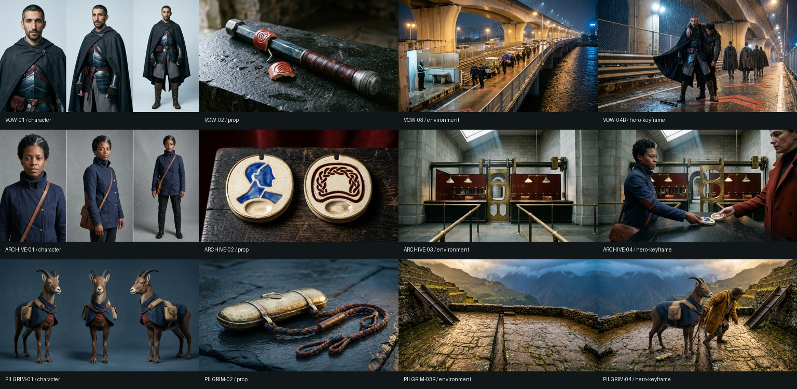

# Mercy studies — original asset pilot

Three coherent original design packs: **The Uncommanded**, **The Price of a Face**, and **The Burden Carried**.

These are visual-development assets, not proof of a completed narrative or a deployed film. The material studies and reference sheets are intentionally not homepage footage. Generated via OpenRouter; later shots were conditioned on our own earlier images. Third-party community footage was not copied into this library or uploaded as conditioning.

| Pack | Character | Prop | Environment | Hero keyframe |
|---|---|---|---|---|
| The Uncommanded | [VOW-01](vow-01.webp) | [VOW-02](vow-02.webp) | [VOW-03](vow-03.webp) | [VOW-04B](vow-04b.webp) |
| The Price of a Face | [ARCHIVE-01](archive-01.webp) | [ARCHIVE-02](archive-02.webp) | [ARCHIVE-03](archive-03.webp) | [ARCHIVE-04](archive-04.webp) |
| The Burden Carried | [PILGRIM-01](pilgrim-01.webp) | [PILGRIM-02](pilgrim-02.webp) | [PILGRIM-03B](pilgrim-03b.webp) | [PILGRIM-04](pilgrim-04.webp) |

## Verification and limits

- 14 initial/revision requests produced 12 selected still assets. Two rejected layouts remain in private production provenance; they are not counted as accepted outputs.
- Every selected image was visually inspected. A too-wide mountain gap and cloned background faces were corrected with distinct recorded edit requests.
- The archivist coat is shorter than the initial brief; continuity follows the generated design. Some plot meanings require a sequence, not a single frame.
- Published WebP previews retain original dimensions without cropping. Unmodified PNG originals, receipts, complete prompts and private production records remain in owned local storage.
- See [manifest.json](manifest.json) for model, hashes, dimensions and derivative lineage. These are AI-generated production studies, not creator-supplied stock.
